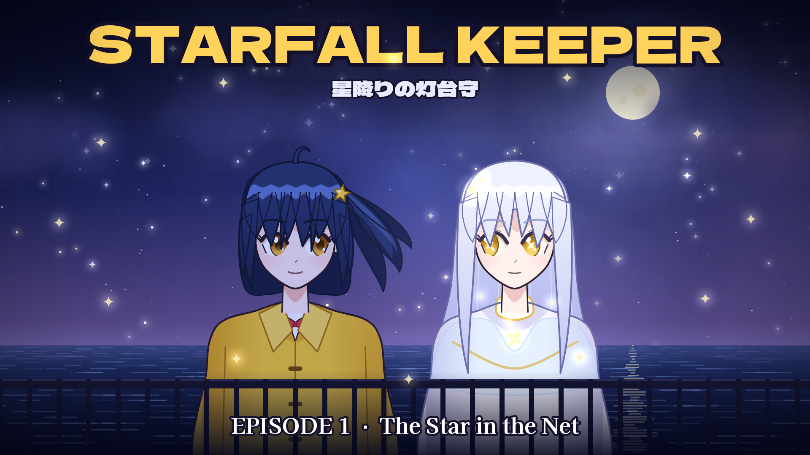
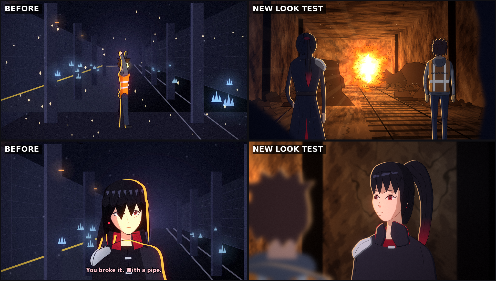

# STARFALL KEEPER · 星降りの灯台守

An original anime made entirely from code with free tools.

**▶ Episode 1 — "The Star in the Net"** · [`episode01/Starfall_Keeper_EP01.mp4`](episode01/Starfall_Keeper_EP01.mp4)
(≈4 min, 1920×1080, 24 fps, English voices + subtitles)



> On Kasumi Island, the old fishermen say that every falling star is a wish somebody gave up on.
> Mio never believed them, until the night a star fell into her grandfather's fishing net
> and turned out to be a girl named Lumi, who has seven nights to get home before her light goes out.

- Script: [`episode01/SCRIPT.md`](episode01/SCRIPT.md)
- Characters: [`episode01/CHARACTERS.md`](episode01/CHARACTERS.md)

## What's in Episode 1

Cold open → opening title sequence with character cards → Part A (the beach) → Part B
(the lighthouse) → Part C (the promise) → villain tag → ending credits → next-episode preview.

| | How it was made | Cost |
|---|---|---|
| Characters & backgrounds | Vector-drawn frame by frame in Python with **skia-python** (`studio/characters.py`, `studio/backgrounds.py`) | free |
| Animation | Blinks, hair sway, floating hair, camera moves, light effects, lip sync from the voice waveform | free |
| Voices | **Kokoro-82M** text-to-speech (Apache-2.0), run locally | free |
| Music & SFX | Synthesized from scratch with **NumPy/SciPy**: piano, plucked guitar, strings, pads, drums, bells, reverb, waves, wind, rain, thunder | free |
| Fonts | Dela Gothic One, M PLUS Rounded 1c, Kaisei Decol (SIL Open Font License) | free |
| Encoding | **FFmpeg** (H.264 + AAC) | free |

## Second show: FAULTLINE (original action anime)

**▶ Episode 1 — "Rank F"** · [`faultline/episode01/FAULTLINE_EP01.mp4`](faultline/episode01/FAULTLINE_EP01.mp4) (≈3 min)

Kai Arisawa, a Rank-F salvager who cleans up after monster hunters, is trapped when a new fracture
opens in a subway dungeon, and discovers he can see the fault lines running through everything.
Code: [`faultline/`](faultline/) (characters, backgrounds, effects, score, episode).
Build: `python studio/render.py --show faultline.ep01`

## Look test: painted backgrounds + cel characters

The first two episodes look like motion graphics, not TV anime. [`cel/`](cel/) is a prototype of a
closer look: painted-style backgrounds mapped in true perspective, natural body proportions, thin
colour-traced lines, scene lighting, out-of-focus foregrounds.



Run `python cel/lookdev.py` to regenerate the test frames in `cel/lookdev/`.

## Build it yourself

```bash
pip install -r requirements.txt
sudo apt-get install -y libegl1 libgl1 espeak-ng ffmpeg   # Linux
mkdir -p models && cd models
curl -LO https://github.com/thewh1teagle/kokoro-onnx/releases/download/model-files-v1.0/kokoro-v1.0.onnx
curl -LO https://github.com/thewh1teagle/kokoro-onnx/releases/download/model-files-v1.0/voices-v1.0.bin
cd ..
python studio/render.py --jobs 4          # → episode01/Starfall_Keeper_EP01.mp4
python studio/render.py --shot-stills     # quick preview: one PNG per shot in build/stills/
```

## Skills & plugins

- **Project skill:** [`.claude/skills/anime-episode/SKILL.md`](.claude/skills/anime-episode/SKILL.md)
  teaches Claude Code how to use this pipeline to make Episode 2 and later episodes.
- **Free plugins from the Claude plugin directory** that fit this kind of work (add them from the
  install card in the chat, or claude.ai → Settings → Plugins):
  - *animation-studio*: code-drawn animated shorts with synthesized soundtrack (local, free)
  - *SoundWeaver*: 52 ready-made sound effects (local, free)
  - *Video Cleanup*: audio/picture cleanup, watermark, lower thirds, end cards (local, free)
  - *image-generation*: prompt-writing guide for text-to-image models (free)
- Left out on purpose because they need a paid or signed-in third-party account: ManyMotions
  "Anime Story Video Maker", CellCog, Creative Claw.

## Repository layout

```
studio/
  gfx.py           drawing helpers (paths, hair locks, glows, sparkles, text)
  characters.py    Mio, Lumi, Grandpa Genzo, the Collector + expressions
  backgrounds.py   sky, sea, lighthouse, beach, interior, crimson sky
  audio.py         voices, lip-sync envelopes, synth instruments, score, SFX, mixing
  ep01.py          the episode: shots, dialogue, camera and effects
  render.py        timeline → audio → parallel frame render → MP4
  fonts/           OFL fonts (licenses included)
episode01/         the finished episode, poster, cast sheet, script, character notes
.claude/skills/    project skill for making more episodes
```

## License notes

Story, characters and code are original to this repo. Fonts are under the SIL OFL (license files
in `studio/fonts/`). Voices are generated with Kokoro-82M (Apache-2.0).
