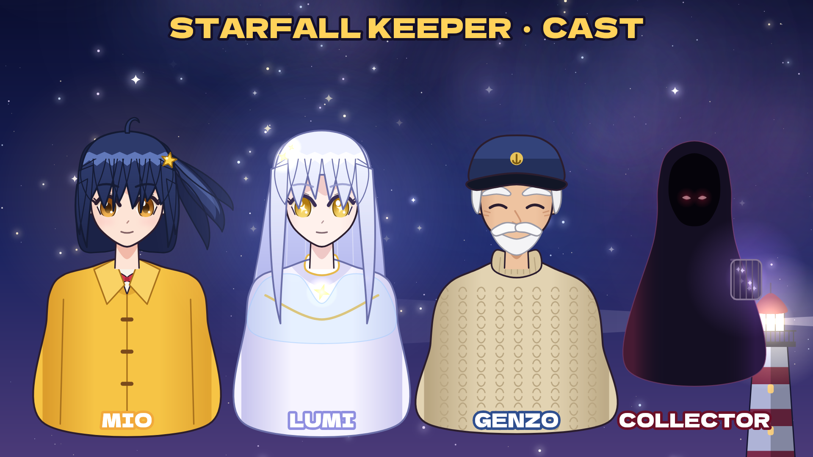

# STARFALL KEEPER — Character Sheet

All characters are original and drawn entirely in code ([`studio/characters.py`](../studio/characters.py)).

| Character | Look | Personality | Voice (Kokoro TTS) |
|---|---|---|---|
| **Mio Tsukishima** (16) | Navy bob with a side ponytail, one "ahoge" strand, amber eyes, gold star hair clip, yellow raincoat over a white blouse with a red ribbon | Stubborn, curious, quick to promise things before thinking them through. Grew up in the lighthouse with her grandfather. | `af_heart` |
| **Lumi** | Long silver hair that floats as if underwater, gold eyes with four-point star pupils, white high-collared dress with gold trim, a star brooch, a soft white glow | A fallen star. Gentle, dreamy, a little lonely. Her glow is her life — it is fading. | `af_nicole` (slowed) |
| **Grandpa Genzo** | Navy captain's cap with an anchor badge, white moustache and beard, bushy brows, cream cable-knit turtleneck, a permanent kind squint | Keeper of the Kasumi light for fifty years. Knows the old stories about the Starfolk — and more than he is saying. | `bm_george` |
| **The Collector** | A hooded cloak with nothing visible inside but two red eyes; carries a lantern-cage full of captured stars | Unknown. Hunts escaped stars. | `bm_lewis` (pitched down, heavy reverb) |

## Setting

**Kasumi Island**: a small fishing island with a red-and-white lighthouse on a cliff, a keeper's
cottage, and a cove where old nets wash up between the rocks. A legend says every falling star
is a wish somebody gave up on.

## Season hooks (for future episodes)

- Lumi has **seven nights** before her light goes out.
- The lighthouse can only shine across the sea. To guide a star home, it would have to be
  turned **toward the sky** (Episode 2: *The Lighthouse That Faces the Sky*).
- Genzo stopped mid-sentence: "you would need..." — what?
- The Collector's lantern holds other stars. Who are they?
